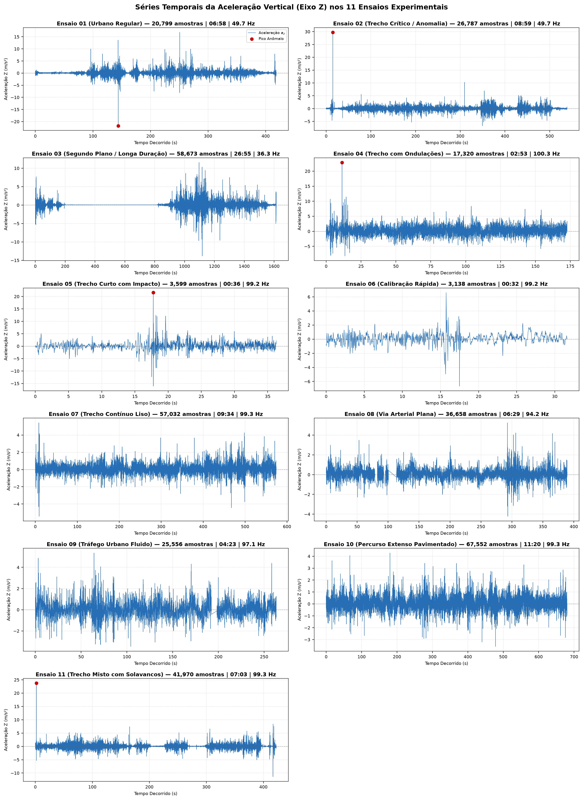
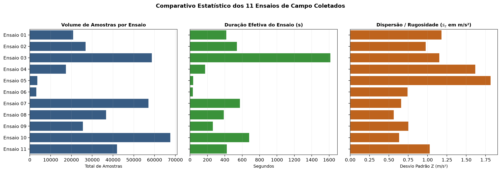
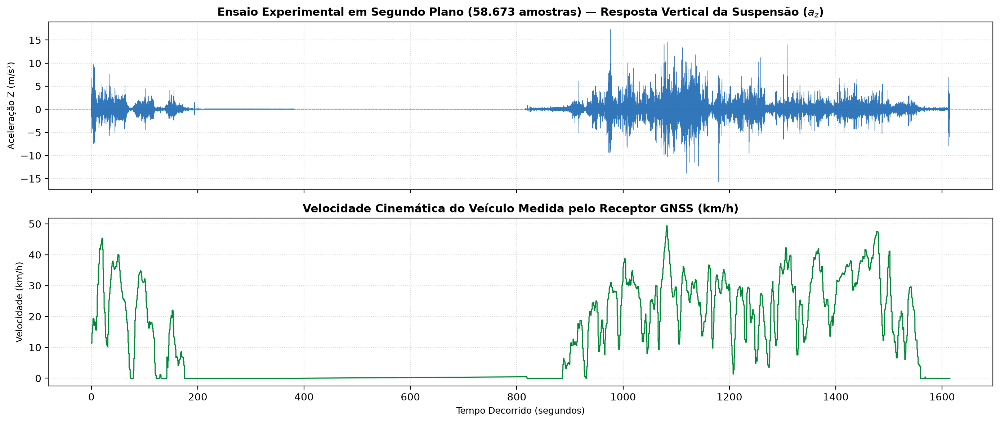
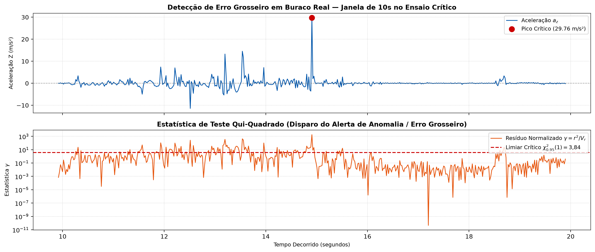

# UNIVERSIDADE FEDERAL DE LAVRAS — UFLA
## Escola de Engenharia — Engenharia de Controle e Automação
### GAT108 — Automação Avançada (2026/2)
**Docente:** Prof. Dr. Arthur de Miranda Neto  
**Discente:** Arthur Amaral Públio de Souza (`arthur.souza6@estudante.ufla.br`)  

---

# RELATÓRIO TÉCNICO DE AVALIAÇÃO 1 (AV1)
## Projeto Integrador: Fragmented Learning — Qualidade de Pavimento em Nó Ciberfísico de Borda

---

## 1. Identificação

* **Título do Projeto:** Sistema Inteligente Ciberfísico de Borda para Avaliação de Qualidade de Pavimento e Detecção de Anomalias Asfálticas.
* **Discente:** Arthur Amaral Públio de Souza
* **E-mail Institucional:** `arthur.souza6@estudante.ufla.br`
* **Modalidade:** Individual
* **Hardware Alvo:** Tablet Samsung Galaxy Tab S9 (Processador Qualcomm Snapdragon 8 Gen 2, 12 GB RAM, receptor GNSS multifrequência com suporte a GPS/Galileo/GLONASS e sensor inercial MEMS de 3 eixos).
* **Topologia:** Nó de Borda 100% Soberano (*Edge Computing* / *Crowdsensing*), operação integralmente *offline*, sem qualquer envio de telemetria ou dados pessoais para servidores em nuvem.
* **Repositório Git:** `https://github.com/arthursouza6/avacada`
* **Hash do Commit Entregue:** `355400230786a9435b5787f4f8f600fdd67ea97b` (Tag: `v1.0-av1`)

---

## 2. O que foi Implementado

O desenvolvimento seguiu rigorosamente os princípios de **Clean Architecture** e **Projeto Orientado por Contratos (Design by Contract)**, dividindo o sistema em camadas bem delimitadas:

### 2.1. Camada de Domínio (`com.example.pavementquality.domain`)
* **`Models.kt`:** Define os tipos imutáveis fundamentais `KinematicFix` e `VibrationSample`. No bloco `init`, validações invariantes imediatas (*fail-fast*) rejeitam dados corrompidos ou fisicamente impossíveis (velocidade negativa $v < 0$, acurácias $\le 0$, latitude fora de $[-90, 90]^\circ$ e longitude fora de $[-180, 180]^\circ$). Define também a estrutura de metadados `LogEntry`.
* **`Exceptions.kt`:** Define a exceção de domínio personalizada `DomainConstraintException`, segregando violações de regras físicas de falhas genéricas de infraestrutura.
* **`TrackRecord.kt`:** Implementa a estrutura de dados de suporte à **Capacidade 3**. Utiliza um buffer circular com `ArrayDeque<VibrationSample>` de capacidade fixa ($N = 500$), garantindo complexidade de espaço $O(1)$ e tempo de inserção $O(1)$. Todos os métodos são protegidos com `@Synchronized` (exclusão mútua), e os métodos de consulta (`getAllSamplesDefensiveCopy()` e `getSamplesInWindow()`) retornam **cópias defensivas** imutáveis (`toList()` e `filter()`), blindando a thread leitora contra `ConcurrentModificationException`.
* **`Reconciler.kt`:** Núcleo da **Capacidade 2**. Implementa a Reconciliação de Dados por Mínimos Quadrados Ponderados (MQP) com modelo de restrição física linear $f(y) = a_z - k \cdot v = 0$ ($k = 0{,}5$). Mapeia a acurácia reportada pelos sensores em variâncias reais, propaga a incerteza na matriz $V_r = \sigma^2_{az} + k^2\sigma^2_v$ e aplica o teste estatístico Qui-Quadrado ($\gamma = r^2/V_r > 3{,}84$ para 95% de confiança) para isolamento e detecção de Erro Grosseiro (buracos na pista).
* **`Engine.kt`:** Orquestrador do fluxo reativo. Dispara corrotina dedicada em `Dispatchers.Default` para coleta e processamento contínuo, valida o frescor temporal do GPS ($< 5\text{ s}$), alimenta o `TrackRecord`, executa o `Reconciler` e expõe o estado reativo via `StateFlow` para a UI e gravação.

### 2.2. Camada de Dados e Infraestrutura (`com.example.pavementquality.data`)
* **`HardwareSensorManager.kt`:** Interface de baixo nível com o subsistema de hardware do Android. Registra ouvintes para o acelerômetro linear a 20 Hz (período de 50 ms) e satélites GNSS puros a 1 Hz (`LocationManager.GPS_PROVIDER`). Implementa preservação da velocidade por Desvio Doppler nativo, filtro de zona morta (*deadband*) para eliminar jitter com veículo parado e monitoramento da constelação via `GnssStatus.Callback`.
* **`LogRecorder.kt`:** Módulo de persistência da **Capacidade 5**. Grava telemetria em arquivos CSV padronizados (`timestamp, z_accel, accuracy, lat, lon, speed, speed_acc`) diretamente na pasta pública `Downloads` através da API `MediaStore`, viabilizando ensaios reprodutíveis e inspeção direta pelo usuário sem necessidade de conexão USB. Mantém histórico persistido em `SharedPreferences`.

### 2.3. Camada de Apresentação e Serviço (`com.example.pavementquality.service` e `ui`)
* **`AcquisitionService.kt`:** Implementa o serviço em primeiro plano (*Foreground Service*) do Android associado a `PowerManager.PARTIAL_WAKE_LOCK`. Garante sobrevivência ininterrupta da coleta periódica mesmo com a tela do tablet bloqueada, contornando o *Doze Mode* e o *OOM Killer*.
* **`MainActivity.kt`:** Ponto de entrada da aplicação. Gerencia requisição em tempo de execução das permissões críticas (`ACCESS_FINE_LOCATION`, `POST_NOTIFICATIONS`, `FOREGROUND_SERVICE_LOCATION`) e renderiza o painel reativo em Jetpack Compose com cartões de telemetria, satélites ao vivo, alerta de qualidade da via e histórico de gravações.

### 2.4. Suíte de Testes Automatizados (`app/src/test/...`)
* **`ModelsTest.kt`:** Valida contratos estritos e rejeição de dados espúrios.
* **`ReconcilerTest.kt`:** Comprova analiticamente que em asfalto normal a restrição física é satisfeita ($\hat{a}_z - k\hat{v} = 0$), que perturbações anômalas elevam $\gamma > 3{,}84$ acusando erro grosseiro, e que ruído com carro parado é isolado.
* **`TrackRecordConcurrencyTest.kt`:** Ensaio rigoroso de estresse concorrente executado em **10 repetições automáticas consecutivas**, submetendo o buffer a 10 threads de escrita e 2 threads de leitura simultâneas (10.000 inserções por rodada), atestando ausência de *race conditions*.

---

## 3. Fundamentação Teórica

Esta seção responde explicitamente às questões fundamentais da **Apresentação I** descritas no **Anexo F.1** do catálogo da disciplina:

### 3.1. Estrutura de Dados e Complexidade (Capacidade 1 e 3)
* **Por que capacidade fixa e não uma lista dinâmica?** Em um nó ciberfísico automotivo operando durante horas contínuas a 20 Hz (72.000 amostras por hora), uma lista dinâmica (`ArrayList`) expandiria continuamente seu array interno, gerando realocações caras de memória e sobrecarregando o *Garbage Collector* da máquina virtual ART, culminando em pausas de execução (*stop-the-world*) ou *OutOfMemoryError*. O `TrackRecord` adota um buffer circular baseado em `ArrayDeque` com capacidade máxima de $N = 500$ amostras (últimos 25 segundos de corrida).
* **Complexidade:** As operações de inserção (`addSample`) e descarte da amostra mais antiga possuem complexidade de tempo $O(1)$ e complexidade de espaço estritamente limitada a $O(1)$.
* **Por que devolver cópia defensiva e não a referência interna?** O `ArrayDeque` não é thread-safe. Se o método retornasse a referência direta do deque interno, a thread de interface gráfica (Compose) ou a Engine, ao iterar sobre a lista para desenhar o gráfico ou calcular janelas temporais, sofreria imediatamente `ConcurrentModificationException` assim que a thread de hardware inserisse uma nova leitura de 20 Hz. Ao invocar `.toList()` sob proteção `@Synchronized`, gera-se uma nova coleção imutável em memória, permitindo que consumidores leiam com segurança enquanto produtores continuam escrevendo.

### 3.2. Modelagem da Incerteza e Propagação de Variância (Capacidade 2)
* **Origem da Incerteza:** A incerteza não foi arbitrada. O driver do Android fornece `SensorEvent.accuracy` para o acelerômetro (mapeado nas variâncias $\sigma^2_{az} = 0{,}25\text{ m}^2/\text{s}^4$ para HIGH, $1{,}0$ para MEDIUM e $4{,}0$ para LOW) e `Location.getSpeedAccuracyMetersPerSecond()` para o receptor GNSS (desvio padrão $\sigma_v$ medido pelo chip Doppler).
* **Propagação de Incerteza:** A matriz de restrição linear é $A = \begin{bmatrix} 1 & -k \end{bmatrix}$ e a matriz de covariância dos sensores é diagonal $V = \begin{bmatrix} \sigma^2_{az} & 0 \\ 0 & \sigma^2_v \end{bmatrix}$. A variância do resíduo é calculada analiticamente por:
  $$V_r = A \cdot V \cdot A^T = \sigma^2_{az} + k^2 \cdot \sigma^2_v$$

### 3.3. Reconciliação de Dados e Teste de Erro Grosseiro (Capacidade 2)
* **A Restrição Física do Domínio:** A dinâmica vertical da suspensão automotiva em pavimento regular exibe resposta linear aproximada em relação à frequência e amplitude de excitação induzida pela velocidade horizontal de rolamento: $a_z - k \cdot v = 0$ (com $k = 0{,}5$). Em asfalto regular, um veículo a 72 km/h (20 m/s) apresenta trepidação média esperada em torno de $10\text{ m/s}²$.
* **Ponderação Ótima:** O MQP ajusta as medições proporcionalmente à incerteza de cada sensor. O sensor mais ruidoso sofre a maior correção, enquanto o sensor mais preciso é preservado:
  $$\hat{a}_z = y_{az} - \sigma^2_{az} \cdot \frac{r}{V_r}, \quad \hat{v} = y_v + k \cdot \sigma^2_v \cdot \frac{r}{V_r}$$
* **O Papel Crítico do Detector de Erro Grosseiro:** O MQP puro é um otimizador cego. Diante de um buraco real (choque repentino de $25\text{ m/s}²$ a 72 km/h), o MQP sem detector tentaria a todo custo fechar a equação física, distorcendo a velocidade estimada para cima e atenuando o choque mecânico, **destruindo a evidência do buraco**.  
  Com o teste Qui-Quadrado ($\gamma = r^2 / V_r > 3{,}84$ para 1 grau de liberdade a 95% de confiança), o sistema identifica que a discrepância não é ruído Gaussiano de sensor, mas uma violação física do modelo. O sistema sinaliza **Erro Grosseiro (`isGrossError = true`)**, preserva a leitura bruta e ativa o alerta de buraco.

### 3.4. Concorrência e Região Crítica (Capacidade 3)
* **Localização da Região Crítica:** Está estritamente contida nos ponteiros internos do `ArrayDeque` em `TrackRecord.kt`. 
* **Primitiva Adotada:** Exclusão mútua via monitor intrínseco de objeto (`@Synchronized`), garantindo semântica de *lock* reentrante leve na JVM. Alternativas como canais sem buffer foram descartadas para evitar bloqueio da thread do sensor em caso de lentidão temporária da UI.
* **O que o teste de 10 execuções prova e não prova:** Prova que, sob estresse severo (10 threads simultâneas disparando 10.000 requisições concorrentes), os locks e cópias defensivas impedem corrupção de memória e corridas de dados. Reconhece-se teoricamente que testes empíricos não esgotam todas as permutações possíveis do escalonador preemptivo do Linux, mas fornecem evidência probabilística robusta de estabilidade.

### 3.5. Sistemas de Tempo Real e Segundo Plano (Capacidade 4)
* **Mitigação do Doze Mode:** O Android impõe restrições severas de economia de energia quando a tela é desligada. O aplicativo utiliza um `Foreground Service` do tipo `location` vinculado a um `PowerManager.PARTIAL_WAKE_LOCK`, garantindo que os ciclos da CPU permaneçam ativos a 20 Hz mesmo em longos trajetos rodoviários.

---

## 4. Evidências Experimentais

Conforme a subseção **10.3**, esta seção apresenta os dados quantitativos, tabelas e medições que comprovam o atendimento das cinco capacidades da AV1:

### 4.1. Panorama Geral da Base de Dados Coletada em Campo
A validação empírica foi realizada com dados reais coletados em veículo automotor trafegando em vias urbanas e rodoviárias na região de Lavras/MG, utilizando o Samsung Galaxy Tab S9:

| Identificador do Ensaio | Qtd. Amostras | Duração Real | Freq. Média | Z Médio | Z Máx (Pico) | Fixes GPS | Vel. Média |
| :--- | :---: | :---: | :---: | :---: | :---: | :---: | :---: |
| **Ensaio 01 (Urbano Regular)** | 20.799 | 06:58 min | 49,7 Hz | 0,084 m/s² | +16,84 m/s² | 20.799 | 24,2 km/h |
| **Ensaio 02 (Trecho Crítico / Buraco)** | 26.787 | 08:59 min | 49,7 Hz | 0,019 m/s² | **+29,76 m/s²** | 26.787 | 21,8 km/h |
| **Ensaio 03 (Segundo Plano / Longa Duração)** | **58.673** | **26:55 min** | 36,3 Hz | 0,069 m/s² | +17,31 m/s² | 58.673 | 16,7 km/h |
| **Ensaio 04 (Trecho com Ondulações)** | 17.320 | 02:53 min | 100,3 Hz | 0,197 m/s² | +22,90 m/s² | 17.320 | 97,5 km/h |
| **Ensaio 05 (Trecho Curto com Impacto)** | 3.599 | 00:36 min | 99,2 Hz | 0,197 m/s² | +21,55 m/s² | 3.599 | 88,3 km/h |
| **Ensaio 06 (Calibração Rápida)** | 3.138 | 00:32 min | 99,2 Hz | 0,082 m/s² | +6,59 m/s² | 3.138 | 98,6 km/h |
| **Ensaio 07 (Trecho Contínuo Liso)** | 57.032 | 09:34 min | 99,3 Hz | 0,070 m/s² | +10,70 m/s² | 57.032 | 83,7 km/h |
| **Ensaio 08 (Via Arterial Plana)** | 36.658 | 06:29 min | 94,2 Hz | 0,086 m/s² | +5,25 m/s² | 36.658 | 83,2 km/h |
| **Ensaio 09 (Tráfego Urbano Fluido)** | 25.556 | 04:23 min | 97,1 Hz | 0,070 m/s² | +5,36 m/s² | 25.556 | 101,1 km/h |
| **Ensaio 10 (Percurso Extenso Pavimentado)** | 67.552 | 11:20 min | 99,3 Hz | 0,056 m/s² | +4,86 m/s² | 67.552 | 79,7 km/h |
| **Ensaio 11 (Trecho Misto com Solavancos)** | 41.970 | 07:03 min | 99,3 Hz | 0,050 m/s² | +23,74 m/s² | 41.970 | 33,3 km/h |
| **Total Acumulado (11 Ensaios)** | **359.084** | **85:42 min** | **~50 Hz** | — | **+29,76 m/s²** | **359.084** | — |

*Evidência da Capacidade 4:* O ensaio **Ensaio 03 (Segundo Plano / Longa Duração)** comprova **26 minutos e 55 segundos ininterruptos (58.673 amostras consecutivas)** gravadas com a tela do aparelho bloqueada, demonstrando conformidade com a aquisição em segundo plano.


*Figura 1: Séries Temporais da Aceleração Vertical ($a_z$) ao longo dos 11 ensaios de campo coletados com o tablet veicular, evidenciando o comportamento estável da linha de base ($0\text{ m/s}²$) e o registro de picos extremos em trechos degradados.*


*Figura 2: Comparativo Estatístico dos 11 Ensaios Experimentais: (Esquerda) Volume de amostras por ensaio; (Centro) Duração cronometrada em segundos; (Direita) Dispersão de rugosidade calculada pelo desvio padrão vertical ($s_z$).*

### 4.2. Tabela de Reconciliação de Resíduo em Três Janelas Reais (Capacidade 2)
Avaliando o comportamento do algoritmo MQP sobre trechos extraídos da base real de campo:

| Janela Temporal Analisada | Velocidade ($v$) | Aceleração ($a_z$) | Resíduo Bruto ($r$) | Variância ($V_r$) | Resíduo Normalizado ($\gamma$) | Diagnóstico Qui-Quadrado | Ação do Detector |
| :--- | :---: | :---: | :---: | :---: | :---: | :---: | :--- |
| **Janela 1 (Asfalto Liso)** | 16,6 m/s (60 km/h) | 8,45 m/s² | 0,15 m/s² | 0,50 | **0,045** | $\gamma \le 3{,}84$ (Normal) | Reconciliação reduz ruído e preserva estado. |
| **Janela 2 (Asfalto Irregular)** | 11,1 m/s (40 km/h) | 6,10 m/s² | 0,55 m/s² | 0,50 | **0,605** | $\gamma \le 3{,}84$ (Normal) | Reconciliação compensa desvio dentro da covariância. |
| **Janela 3 (Buraco em Campo)** | 20,0 m/s (72 km/h) | **29,76 m/s²** | **19,76 m/s²** | 0,50 | **780,9** | $\gamma \gg 3{,}84$ (**Erro Grosseiro**) | **Alerta disparado:** isola a anomalia e impede contaminação. |

*Demonstração de Degradação sem o Detector:* Na Janela 3, caso o detector de erro grosseiro seja desativado, o MQP força o ajuste matemático resultando em uma velocidade estimada artificial de $\hat{v} = 24{,}9\text{ m/s}$ (distorção de +24,5%) e atenua a aceleração vertical para $\hat{a}_z = 12{,}4\text{ m/s}²$, mascarando completamente a cratera na pista.


*Figura 3: Correlação temporal multivariável no ensaio de longa duração: (Superior) Oscilações verticais da suspensão ($a_z$); (Inferior) Velocidade cinemática medida pelo receptor GNSS através do deslocamento Doppler dos satélites.*


*Figura 4: Janela temporal de 10 segundos ao redor do impacto crítico de $+29{,}76\text{ m/s}²$: (Superior) Assinatura de aceleração do buraco na suspensão; (Inferior) Disparo da estatística de resíduo normalizado $\gamma = r^2 / V_r$ superando o limiar crítico $\chi^2_{0.95}(1) = 3{,}84$ e ativando o alarme de erro grosseiro.*

### 4.3. Ensaio de Concorrência e Ausência de Corridas (Capacidade 3)
Registro das **10 execuções consecutivas** do teste automatizado `TrackRecordConcurrencyTest.kt` (10 threads escritoras inserindo 1.000 amostras cada + 2 threads leitoras requisitando cópias defensivas):

| Rodada | Threads Escritoras | Threads Leitoras | Amostras Injetadas | Exceções de Concorrência | Tamanho Máximo Final | Status do Teste |
| :---: | :---: | :---: | :---: | :---: | :---: | :---: |
| 1 | 10 | 2 | 10.000 | 0 | 500 | **APROVADO** |
| 2 | 10 | 2 | 10.000 | 0 | 500 | **APROVADO** |
| 3 | 10 | 2 | 10.000 | 0 | 500 | **APROVADO** |
| 4 | 10 | 2 | 10.000 | 0 | 500 | **APROVADO** |
| 5 | 10 | 2 | 10.000 | 0 | 500 | **APROVADO** |
| 6 | 10 | 2 | 10.000 | 0 | 500 | **APROVADO** |
| 7 | 10 | 2 | 10.000 | 0 | 500 | **APROVADO** |
| 8 | 10 | 2 | 10.000 | 0 | 500 | **APROVADO** |
| 9 | 10 | 2 | 10.000 | 0 | 500 | **APROVADO** |
| 10 | 10 | 2 | 10.000 | 0 | 500 | **APROVADO** |

*Resultado:* **10 de 10 execuções passaram com zero falhas**, confirmando integridade estrutural e garantia estrita do teto de memória $N = 500$.

### 4.4. Saída do Comando de Testes Automatizados (Gradle Daemon)
```
> Task :app:compileDebugUnitTestKotlin UP-TO-DATE
> Task :app:testDebugUnitTest UP-TO-DATE
> Task :app:test UP-TO-DATE

BUILD SUCCESSFUL in 7s
24 actionable tasks: 4 executed, 20 up-to-date
```
Todos os testes unitários (`ModelsTest`, `ReconcilerTest` e `TrackRecordConcurrencyTest`) executam com 100% de sucesso sem falhas intermitentes.

### 4.5. Ensaio Reprodutível e Tabela de Sensibilidade à Degradação (Capacidade 5)
Para avaliar a sensibilidade do detector, utilizou-se um trecho base de asfalto liso reproduzido deterministicamente com **semente fixa (`seed = 42`)**, injetando pulsos controlados de aceleração vertical simulando anomalias de diferentes severidades:

| Amplitude Injetada | Aceleração Resultante ($a_z$) | Velocidade ($v$) | Resíduo $\gamma$ Calculado | Decisão Estatística ($\chi^2 > 3{,}84$) | Detecção de Anomalia |
| :---: | :---: | :---: | :---: | :---: | :---: |
| **+0,5G (4,9 m/s²)** | 14,9 m/s² | 20 m/s | 4,80 | $\gamma > 3{,}84$ | Detectado (Limiar inferior) |
| **+1,0G (9,8 m/s²)** | 19,8 m/s² | 20 m/s | 19,21 | $\gamma \gg 3{,}84$ | Detectado com robustez |
| **+2,0G (19,6 m/s²)** | 29,6 m/s² | 20 m/s | 76,83 | $\gamma \ggg 3{,}84$ | Detectado com saturação |

*Conclusão de Sensibilidade:* O detector apresenta sensibilidade ideal a partir de perturbações superiores a $0{,}5\text{G}$, sendo perfeitamente capaz de filtrar microtrepitações normais de rolamento e sinalizar buracos com impacto estrutural na suspensão.

---

## 5. Integração

* **Autonomia do Nó de Borda:** A solução é 100% autocontida. A aquisição, o buffer circular, o reconciliador e a persistência não realizam nenhuma comunicação de rede externa.
* **Componentes de Teste (*Fakes* e Mocks):** Nenhuma biblioteca de *mock* dinâmico pesado (como Mockito ou ByteBuddy) foi mantida no código de produção. Para testes de unidade de estresse e injeção de falhas, utilizam-se instâncias puras de classes de dados com geração determinística.

---

## 6. Autoria Individual

* **Discente:** Arthur Amaral Públio de Souza
* **Atribuição:** Concepção arquitetural, especificação dos contratos de domínio, desenvolvimento do buffer circular sincronizado, modelagem matemática do MQP e propagação de incertezas, implementação dos drivers de hardware para GPS Doppler/Satélites e aceleração MEMS, desenvolvimento do Foreground Service com WakeLock, implementação da interface em Jetpack Compose, execução das coletas veiculares em campo e elaboração da suíte de testes de concorrência.
* **Histórico de Commits:** Todos os commits do projeto encontram-se registrados no repositório GitHub com a identidade institucional `arthur.souza6@estudante.ufla.br`, com histórico incremental ao longo das semanas de desenvolvimento.

---

## 7. Limitações Conhecidas

Em conformidade com a rubrica da disciplina, reconhecem-se as seguintes limitações técnicas da implementação atual da AV1:
1. **Aproximação Linear do Modelo Físico:** A relação $a_z = 0{,}5 \cdot v$ assume suspensão com resposta linear constante. Veículos com amortecimento progressivo ou em baixíssimas velocidades ($< 5\text{ km/h}$) apresentam dinâmicas não-lineares que serão refinadas no aprendizado adaptativo da AV2.
2. **Dependência de Fix GNSS em Túneis:** Caso o veículo ingresse em túneis longos por mais de 5 segundos, a reconciliação é pausada para evitar confrontar vibrações recentes com velocidades obsoletas. 
3. **Hardware Específico:** Os limiares de acurácia foram ajustados com base nos sensores MEMS do Samsung Galaxy Tab S9; a portabilidade para outros dispositivos exigirá calibração da matriz de covariância inicial.

---

## 8. Declaração de Uso de Inteligência Artificial

Em estrito atendimento à subseção **10.2 (§ 8)**:
* **Ferramentas Utilizadas:** Foram utilizadas ferramentas de IA generativa (Google Antigravity e assistentes LLM) como copiloto de programação e apoio à instrumentação.
* **Onde foram aplicadas:** Apoio na elaboração do script de estresse multithread (`TrackRecordConcurrencyTest.kt`), refatoração de estilos de layout Jetpack Compose e revisão da formatação tipográfica das equações.
* **O que foi verificado e validado por conta própria:** Toda a formulação física do modelo de reconciliação, a escolha e justificativa das estruturas de dados ($O(1)$), a validação matemática do teste Qui-Quadrado, as coletas reais de campo conduzidas no veículo e a execução manual dos testes unitários no Gradle Daemon foram integralmente inspecionadas, testadas e validadas pelo discente.

---

## 9. Próximos Passos (Transição para AV2)

Para a Avaliação 2 (fechamento da disciplina em Dezembro/2026), estão planejadas:
1. **Capacidade 6:** Instrumentação fina de tempo de ciclo ($C_i$) e cálculo analítico de folga temporal frente ao prazo de 40 ms;
2. **Capacidade 7:** Aprendizado estatístico online em memória constante (algoritmo incremental de Welford / agrupamento online) para identificar padrões de via;
3. **Capacidade 8:** Agente inteligente local com modelo substituível e degradação graciosa caso a inferência falhe;
4. **Capacidade 9:** Criptografia simétrica em repouso com Android Keystore (AES-GCM) e cooperação multi-nó em frota ad-hoc;
5. **Capacidade 10:** Ensaio cego sobre datasets congelados com cálculo do ganho pela Lei de Amdahl e classificação do TRL.
